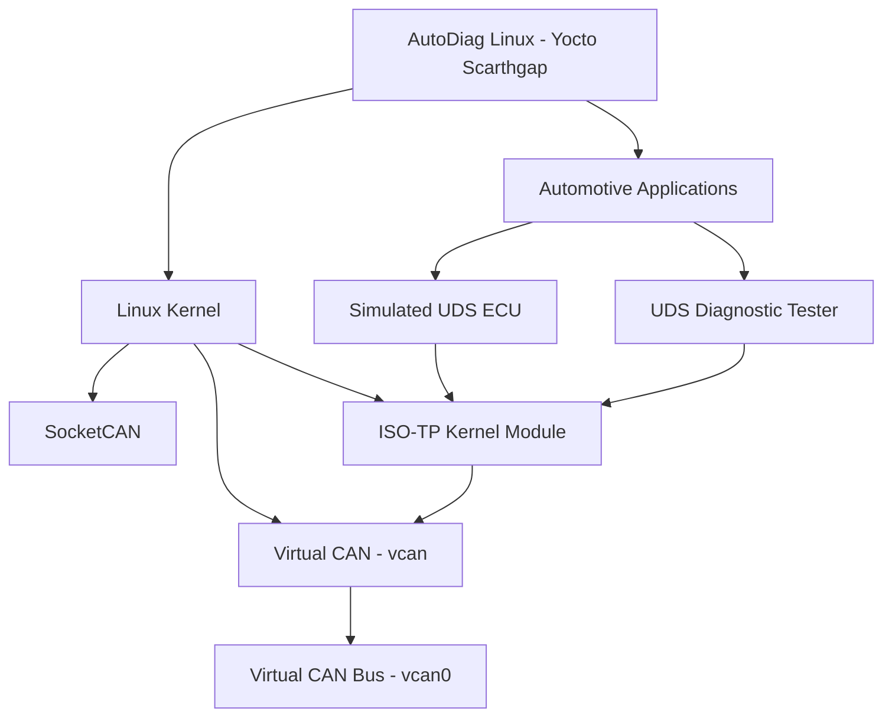

# AutoDiag Linux

**A Yocto-based embedded Linux platform for automotive diagnostics using SocketCAN, ISO-TP, and UDS.**

AutoDiag Linux is an embedded Linux distribution built with the Yocto Project (Scarthgap) and KAS. It targets QEMU x86-64 and provides a foundation for developing and testing automotive diagnostic applications on Linux.

The current implementation demonstrates end-to-end UDS communication between a simulated ECU and a diagnostic tester over Linux ISO-TP sockets and a virtual CAN interface.

## Project objectives

- Build a custom embedded Linux distribution using Yocto.
- Integrate Linux SocketCAN and virtual CAN support.
- Enable kernel ISO-TP communication.
- Implement a simulated UDS ECU in C.
- Implement a native Linux ISO-TP diagnostic tester in C.
- Validate UDS ReadDataByIdentifier communication using DID `F190`.

## System architecture



## Technology stack

| Component | Technology |
|---|---|
| Build system | Yocto Project |
| Release | Scarthgap |
| Build orchestration | KAS |
| Target machine | QEMU x86-64 |
| Kernel | Linux 6.6.160 |
| CAN interface | SocketCAN / vcan |
| Transport protocol | Linux ISO-TP |
| Diagnostic protocol | UDS |
| Application language | C |
| Development environment | WSL2, Ubuntu, Docker |

## Current implementation

### Kernel integration

The custom kernel configuration enables:

- `CONFIG_CAN`
- `CONFIG_CAN_RAW`
- `CONFIG_CAN_VCAN`
- `CONFIG_CAN_ISOTP`

The `vcan` and `can-isotp` kernel modules are packaged in the image.

### UDS ECU simulator

The `autodiag-ecu` application simulates an ECU. It listens for diagnostic requests using an ISO-TP socket.

Current supported service:

- `0x22` — ReadDataByIdentifier
- DID `F190` — simulated VIN

### Diagnostic tester

The `autodiag-isotp-test` application sends a UDS request, receives the ECU response, validates the positive response SID and DID, and checks the returned VIN.

## Build instructions

Clone the repository and enter the project directory.

Build the image using the Docker/KAS wrapper:

```bash
./docker/docker.sh build kas/auto-diag-linux.yml
```

The build targets `qemux86-64` and produces the `core-image-minimal` image.

## Runtime test

Inside the booted QEMU guest, configure the virtual CAN interface:

```bash
modprobe vcan
modprobe can-isotp

ip link add dev vcan0 type vcan
ip link set vcan0 up
```

Start the simulated ECU:

```bash
autodiag-ecu > /tmp/autodiag-ecu.log 2>&1 &
sleep 1
```

Run the diagnostic tester:

```bash
autodiag-isotp-test
```

Expected result:

```text
AutoDiag UDS Tester

Service     : ReadDataByIdentifier (0x22)
DID         : F190 (VIN)

Simulated VIN: AUTODIAG000000001

TEST PASS
```

## Project status

**Implemented and tested**
- Yocto Scarthgap distribution for QEMU x86-64.
- SocketCAN and virtual CAN kernel support.
- Linux ISO-TP kernel support.
- CAN frame transmission and reception using `can-utils`.
- C-based simulated UDS ECU.
- C-based ISO-TP diagnostic tester.
- End-to-end UDS `0x22 / F190` communication.

**Planned**
- Additional UDS diagnostic services.
- Diagnostic trouble code handling.
- ECU session management and security access.
- Automated integration tests.
- Diagnostic logging and reporting.
- Qt-based diagnostic interface.
- Performance and image-size optimization.

## Project scope

This is an actively developed engineering project and a QEMU-based proof of concept. The current simulated ECU and VIN are for development and testing; they do not represent a real vehicle ECU or production diagnostic system.
